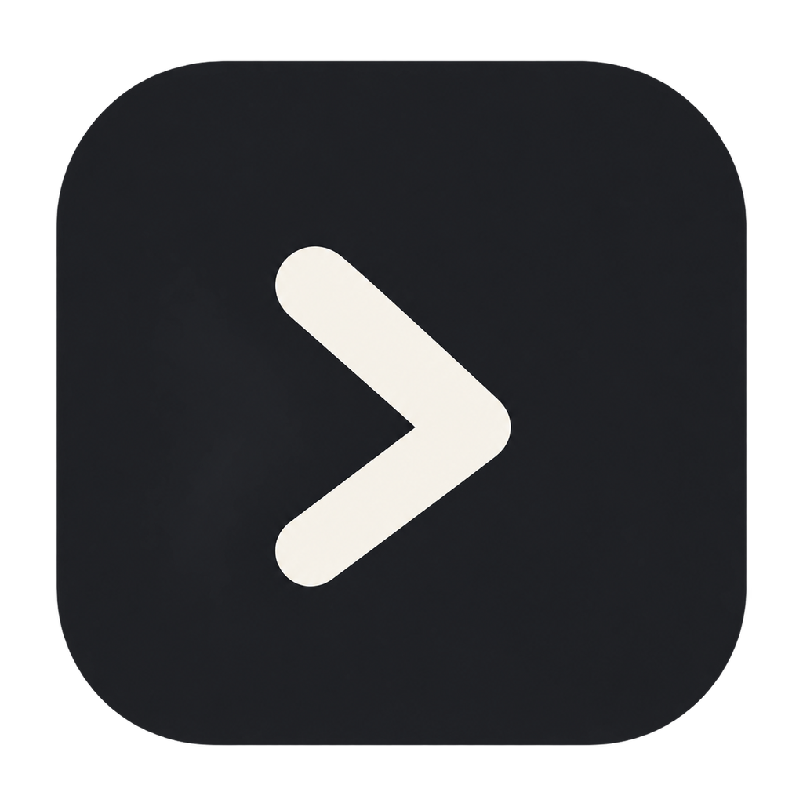
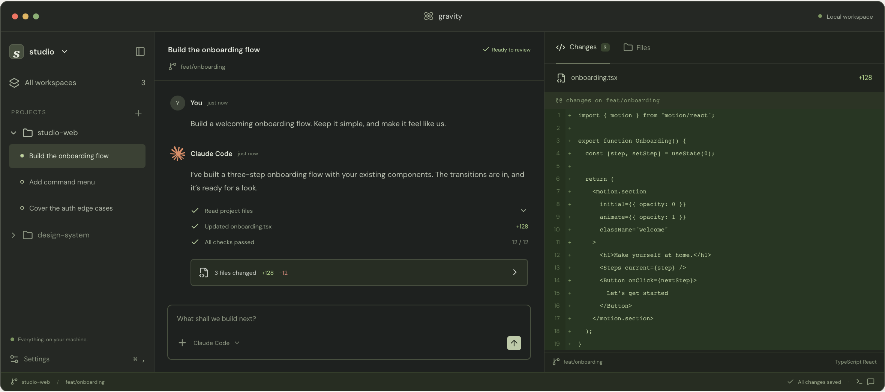

<p align="center">
  
</p>

<h1 align="center">Gravity</h1>

<p align="center">
  <a href="README.md">English</a> ·
  <a href="README.zh-CN.md">简体中文</a> ·
  <a href="README.ja.md">日本語</a> ·
  <a href="README.ko.md">한국어</a>
</p>

<p align="center">
  <a href="https://github.com/gravity-code-hq/gravity/stargazers">
    
  </a>
  <a href="https://github.com/gravity-code-hq/gravity/releases">
    
  </a>
</p>

<p align="center">Claude Code, Codex, Copilot, OpenCode, Pi 에이전트를 위한 하나의 인터페이스</p>

<p align="center">
  
</p>

내 컴퓨터에서 에이전트를 병렬로 실행하세요. 데스크톱이나 휴대폰에서 배포하세요.

- **셀프 호스팅:** 에이전트는 완전한 개발 환경이 갖춰진 내 컴퓨터에서 실행됩니다. 평소 쓰던 도구, 설정, 스킬을 그대로 쓸 수 있습니다.
- **여러 제공자 지원:** Claude Code, Codex, Copilot, OpenCode, Pi를 하나의 인터페이스에서 사용할 수 있습니다. 작업마다 알맞은 모델을 고를 수 있습니다.
- **음성 제어:** 음성 모드에서 작업을 말로 지시하거나 문제를 음성으로 함께 검토할 수 있습니다. 손을 쓰지 않고 작업해야 할 때 유용합니다.
- **여러 기기 지원:** iOS, Android, 데스크톱, 웹, CLI를 지원합니다. 데스크톱에서 시작해 휴대폰으로 확인하고 터미널에서 자동화할 수 있습니다.
- **개인정보 보호 우선:** Gravity는 텔레메트리, 추적, 강제 로그인을 사용하지 않습니다.

## 시작하기

Gravity는 코딩 에이전트를 관리하는 로컬 서버인 데몬을 실행합니다. 데스크톱 앱, 모바일 앱, 웹 앱, CLI 같은 클라이언트가 이 데몬에 연결합니다.

### 준비 사항

아래 에이전트 CLI 중 하나 이상을 설치하고 인증 정보를 설정해야 합니다.

- [Claude Code](https://docs.anthropic.com/en/docs/claude-code)
- [Codex](https://github.com/openai/codex)
- [GitHub Copilot](https://github.com/features/copilot/cli/)
- [OpenCode](https://github.com/anomalyco/opencode)
- [Pi](https://pi.dev)

### 데스크톱 앱(권장)

[github.com/gravity-code-hq/gravity/download](https://github.com/gravity-code-hq/gravity/download) 또는 [GitHub 릴리스 페이지](https://github.com/gravity-code-hq/gravity/releases)에서 다운로드하세요. 앱을 열면 데몬이 자동으로 시작됩니다. 별도로 설치할 것은 없습니다.

휴대폰에서 연결하려면 **설정 → 호스트 → 기기 페어링**을 여세요.

### CLI / 헤드리스 환경

CLI를 설치하고 Gravity를 시작하세요.

```bash
npm install -g @gravity/cli
gravity
```

Gravity가 로컬에서 시작된 뒤 기기 페어링을 위한 종단 간 암호화 릴레이를 켤지 묻습니다. 거절하면 TCP, Tailscale 또는 다른 VPN으로 직접 연결할 수 있습니다. 이 방식은 서버나 원격 머신에서 유용합니다.

자세한 설치와 설정은 아래 문서를 참고하세요.

- [문서](https://github.com/gravity-code-hq/gravity/docs)
- [연결 가이드](https://github.com/gravity-code-hq/gravity/docs/connectivity)
- [설정 레퍼런스](https://github.com/gravity-code-hq/gravity/docs/configuration)

### Docker

Docker에서 Gravity 데몬과 셀프 호스팅 웹 UI를 실행하세요:

```bash
docker run -d --name gravity \
  -p 6767:6767 \
  -e GRAVITY_PASSWORD=change-me \
  -v "$PWD/gravity-home:/home/gravity" \
  -v "$PWD:/workspace" \
  ghcr.io/gravity-code-hq/gravity:latest
```

컨테이너가 시작되면 `http://localhost:6767`을 여세요. 사용하는 에이전트 CLI를 기본 이미지에 추가한 뒤, 환경 변수나 영구 `/home/gravity` 볼륨으로 인증 정보를 설정하세요. 자세한 내용은 [Docker 문서](docs/docker.md)를 참고하세요.

## CLI

앱에서 할 수 있는 모든 작업은 터미널에서도 할 수 있습니다.

```bash
gravity run --provider claude/opus-4.6 "implement user authentication"
gravity run --provider codex/gpt-5.4 --worktree feature-x "implement feature X"

gravity ls                           # 실행 중인 에이전트 목록
gravity attach abc123                # 실시간 출력 스트리밍
gravity send abc123 "also add tests" # 후속 작업 전송

# 원격 데몬에서 실행
gravity --host workstation.local:6767 run "run the full test suite"
```

자세한 내용은 [전체 CLI 레퍼런스](https://github.com/gravity-code-hq/gravity/docs/cli)를 참고하세요.

## 스킬

스킬은 에이전트가 Gravity를 통해 다른 에이전트를 오케스트레이션하는 방법을 알려 줍니다.

```bash
npx skills add gravity-code-hq/gravity
```

그런 다음 어떤 에이전트 대화에서든 아래 명령을 사용할 수 있습니다.

- `/gravity-handoff` — 에이전트 간에 작업을 넘깁니다. Claude로 계획을 세운 뒤 Codex에 구현을 넘길 때 이 기능을 씁니다.
- `/gravity-advisor` — 작업 자체를 넘기지 않고, 에이전트 하나를 조언자로 띄워 두 번째 의견을 받습니다.
- `/gravity-committee` — 서로 다른 관점의 에이전트 두 개로 위원회를 구성해, 한 발 물러나 근본 원인을 분석하고 계획을 세웁니다.

## 개발

모노레포 패키지 구성은 다음과 같습니다.

- `packages/server`: Gravity 데몬(에이전트 프로세스 오케스트레이션, WebSocket API, MCP 서버 제공)
- `packages/app`: Expo 클라이언트(iOS, Android, 웹)
- `packages/cli`: `gravity` CLI(데몬과 에이전트 워크플로)
- `packages/desktop`: Electron 데스크톱 앱
- `packages/relay`: 데몬과 클라이언트가 쓰는 릴레이 전송 및 암호화 패키지
- `packages/gravity-website`: 마케팅 사이트 및 다운로드 페이지

자주 쓰는 명령:

```bash
# 모든 로컬 개발 서비스 실행
npm run dev

# 개별 환경 실행
npm run dev:server
npm run dev:app
npm run dev:desktop
npm run dev:website

# 서버 스택 빌드
npm run build:server

# 레포 전체 검사 실행
npm run typecheck
```

## 라이선스

Gravity는 [MIT License](LICENSE)에 따라 제공됩니다.

Gravity에는 [Apache License 2.0](LICENSES/Apache-2.0.txt)으로 라이선스된 다른 프로젝트의 코드가 포함되어 있습니다. 해당 코드는 계속 Apache 2.0을 따릅니다. 저작자 표시는 [NOTICE](NOTICE)를 참고하세요. 서드파티 구성 요소는 각자의 라이선스를 따릅니다.
